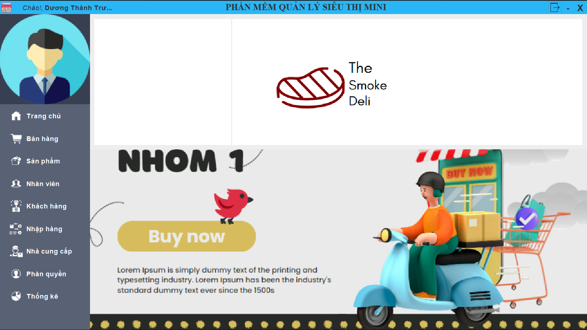

# Hotel Management Software 
The mini supermarket management software project is an application designed to help efficiently manage and organize activities within a mini supermarket. This software includes features such as inventory management, sales management, employee management, and revenue statistics. This makes inventory management, revenue and profit calculations, as well as employee management, easier and quicker.

## Setting
1. **JKD**
   [Download JDK here](https://www.oracle.com/java/technologies/downloads/)
2. **ECLIPSE**
   [Download Eclipse here](https://www.eclipse.org/downloads/)
3. **JDBC Driver library**
   [Download JDBC Driver here](https://www.oracle.com/vn/database/technologies/appdev/jdbc-downloads.html)
4. **jfreechart**
   [Download jfreechart here](https://www.jfree.org/jfreechart/download.html)
5. **jCalendar**
   [Download jCalendar here](http://www.java2s.com/Code/Jar/j/Downloadjcalendar132jar.htm)
6. **Project**
   ```bash
   git clone https://github.com/BT2701/Hotel-management-software-construction-and-development-project.git
   ```
7. **Import Database**
  open file 'Database/qlst_mn.sql' in phpMyAdmin (Xampp tool) and run file
  
## USING
1. **run file 'src/GUI/mainGUI.java'**
2. **login**
   
3. **Main Interface**
   

## Contributing
   Contributions are welcome! If you find any issues or have suggestions for improvements, please open an issue or submit a pull request.

## LICENSE
   This project is licensed under the [MIT License](./LICENSE.txt).